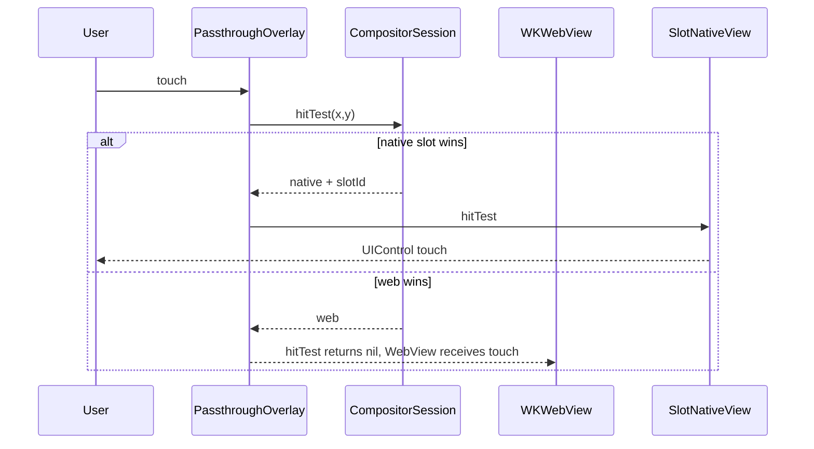

# iOS overlay and WebView touch proof (milestone 1)

This milestone wires a **live iOS overlay** above the Capacitor `WKWebView` and routes touches using the shared compositor hit-test rules.

## Components

| File | Role |
| ---- | ---- |
| `HybridUiOverlayHost.swift` | Attaches full-screen overlay sibling; positions slot views |
| `HybridUiPassthroughOverlayView` | `hitTest(_:with:)` returns slot subviews for native hits, `nil` for Web hits (pass-through to WebView) |
| `HybridUiSlotNativeView` | Demo `UIControl` per slot; emits `pointerRouted` on tap |
| `HybridUiCompositorSession.swift` | Authoritative stack, scroll-adjusted frames, descending-z hit-test |

## Touch flow

## Geometry, scroll, rotation

- **Resize / rotate:** JS sends `updateSlotGeometry` with viewport-relative CSS pixels; plugin updates session frames and `slotView.frame`.
- **Scroll:** `bindScrollGroup` + `reportScroll` subtract content offset from slot base frames (same sign as `example/behavior.spec.md` scroll scenario).
- **Viewport:** Updated from `webView.bounds` on geometry passes (spike assumes 1 CSS px == 1 point; device scale refinement is future work).

## Z-index proof cases

Covered by `ios/Tests/HybridUiCompositorSessionTests.swift`, `android/src/test/...`, and `src/hit-test.test.ts`:

- `modal.nativeHudAboveWebModal`
- `modal.webBlocksToolbar`
- `scroll.nativeAdFollowsFeed` (frame math)

## Manual check in a Capacitor app

1. `createSession`, register toolbar + ad slots, call `updateSlotGeometry` from `getBoundingClientRect`.
2. Tap ad slot: native orange control receives touch; `pointerRouted` target `native`.
3. `presentLayer` modal-web at z 1000 with `blocksPointerBelow`; tap toolbar: WebView receives touch (`pointerRouted` target `web`).
4. Register HUD slot at z 2000 over modal corner; tap HUD: native slot receives touch.

## Not proven here

- Real plugin SDK views (only demo `UIControl` slots)
- WKWebView internal modal DOM without `presentLayer`
- Liquid Glass / video layers
- Pixel-perfect scale between CSS and native on all devices
